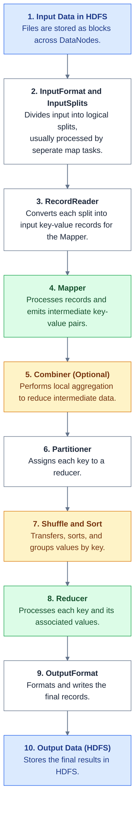

Build in namenode

```bash
dxcit namenode /bin/bash

cd /tmp/wordcount-build

ls
WordCount.java

# Compile the Java 
javac -cp "$(hadoop classpath)" -d . WordCount.java

# Compile will produce
ls *.class
'WordCount$SumReducer.class'  'WordCount$TokenizerMapper.class'   WordCount.class

# Package the compiled classes into a JAR
jar -cvf wordcount.jar *.class
added manifest
adding: WordCount$SumReducer.class(in = 1749) (out= 748)(deflated 57%)
adding: WordCount$TokenizerMapper.class(in = 1915) (out= 822)(deflated 57%)
adding: WordCount.class(in = 1670) (out= 937)(deflated 43%)

# Verify the JAR contains the classes
jar -tf wordcount.jar
META-INF/
META-INF/MANIFEST.MF
WordCount$SumReducer.class
WordCount$TokenizerMapper.class
WordCount.class
```

### Put test input

```bash
printf 'Hello Hadoop Hello World\nHadoop MapReduce World\n' > /tmp/input.txt

hdfs dfs -put -f /tmp/input.txt /user/hojat/wordcount/input/

hdfs dfs -cat /user/hojat/wordcount/input/input.txt
Hello Hadoop Hello World
Hadoop MapReduce World

```

## Run the MapReduce job

Remove the old output directory if it exists. Hadoop normally refuses to write to an existing output directory

```bash
hdfs dfs -rm -r -f /user/hojat/wordcount/output
```

Submit the job

```bash
hadoop jar /tmp/wordcount-build/wordcount.jar WordCount \
/user/hojat/wordcount/input \
/user/hojat/wordcount/output \
```

Inspect the result:

```bash
hdfs dfs -cat /user/hojat/wordcount/output/part-r-00000
hadoop	2
hello	2
mapreduce	1
world	2
```

And the result is available on every datanodes:
```bash
dps | grep data | awk '{print $14}'
datanode1
datanode2
datanode3

 dps | grep data | awk '{print $14}' | xargs -I {} docker exec {} cat /data/hadoop/data/current/BP-1307039919-10.200.0.2-1793272215002/current/finalized/subdir0/subdir0/blk_1073741829
hadoop	2
hello	2
mapreduce	1
world	2
hadoop	2
hello	2
mapreduce	1
world	2
hadoop	2
hello	2
mapreduce	1
world	2
```

## MapReduce execution pipeline without YARN

In Chapter 2, MapReduce, Analyzing the Data with Hadoop we we had hadoop data flow for a weather proccess to calculate air temprature, here we are going to take a look at the word count example


1. Hadoop MapReduce execution flow



### Example: WordCount

Input file:
```bash
cat dog cat
dog bird
```

**Step1:** Input records

| key | Value |
| :--: | :--: |
| 0  | cat dog cat |
| 12 | dog brid |

They **Key** is the byte offset of the line, and the value is the line's text

**Step 2:** Mapper

The `WordCount.java` mapper splits each line into words and emits `(word, 1)`.

mapper output 

| Map task 1 | Map task 2 |
| :--: | :--: |
| (cat, 1) | (dog, 1) |
| (dog, 1) | (bird, 1) |
| (cat, 1) |  |

**Step 3:** Shuffle and sort

Hadoop brings all records with the same key together.

| Key | Values |
| :--: | :--: |
| bird | [1] |
| cat | [1, 1] |
| dog | [1, 1] |

The shuffle transfers intermediate records from mapper outputs to the appropriate reducers, Sorting and grouping organize them by key.

**Step 4:** Reducer

The Reducer sums the values for each word.

| key  | Sum |
| :--: | :--: |
| bird | 1 |
| cat | 2 |
| dog | 2 |


**Step 5:** Output 

The result are written to HDFS, typically to a directory such as /output/part-r-00000.

```text
bird 1
cat 2
dog 2
```


Hadoop's parallelism comes from processing multiple input splits simultaneously.

- **Map phase:** Hadoop creates logical input splits, Multiple map tasks can process different splits concurrently.
- **Data locality:** Hadoop tries to run map tasks on or near the machines storing the required blocks, reducing network traffic.
- **Shuffle phase:** Mapper outputs are partitioned and transferred to reducers.
- **Reduce phase:** Multiple reducers can process different groups of keys concurrently.


